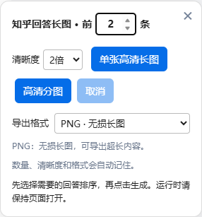
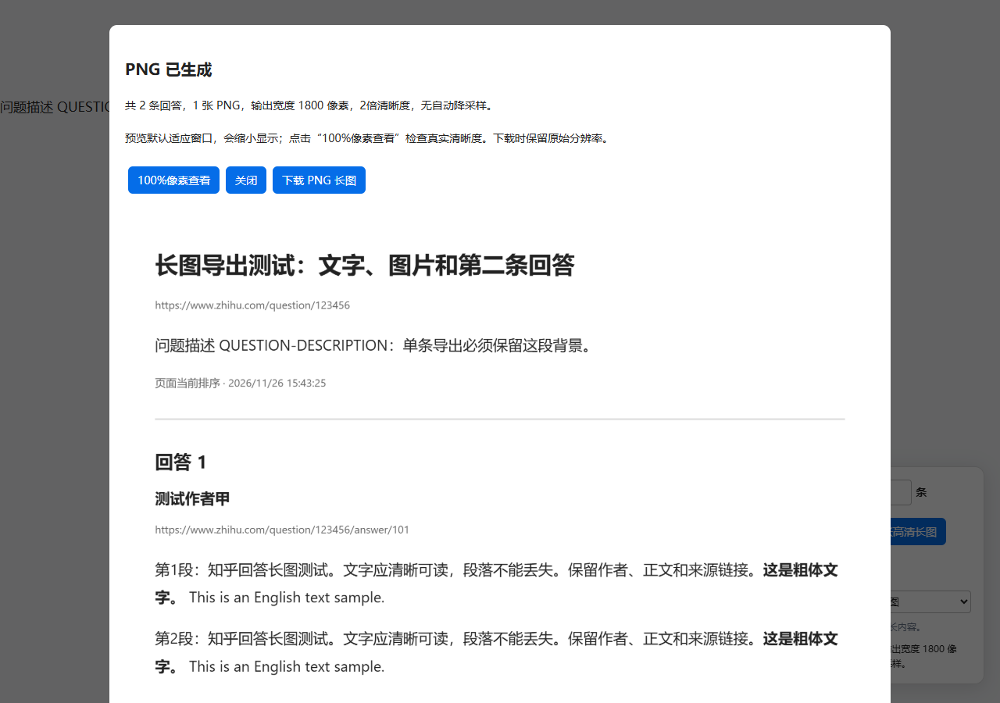
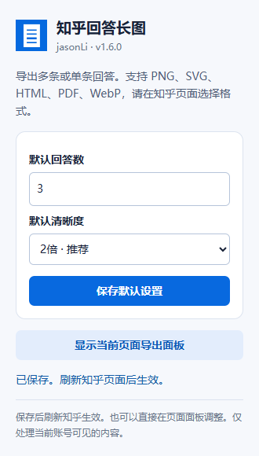
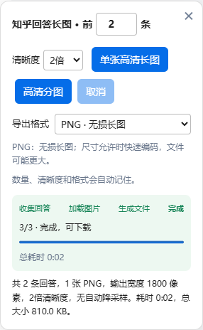
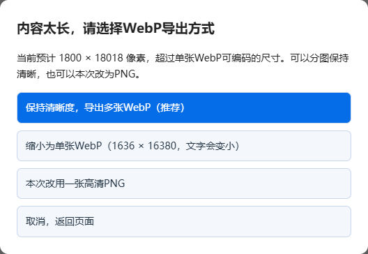
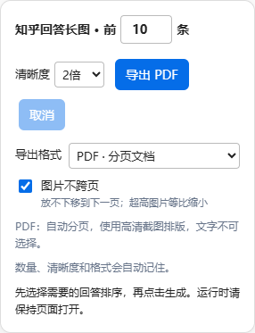
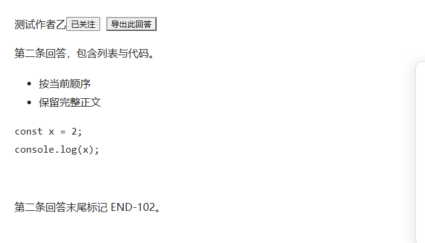

# 知乎回答长图

作者：**jasonLi**。按知乎提问页面的当前排序，收集前 X 条回答，导出一张高清 PNG 长图。提供 **Tampermonkey 油猴脚本**与 **Chrome / Edge 扩展**两种使用方式。

**[安装与更新指南](docs/install.html)**：下载源码后可直接用浏览器打开，扩展弹窗中也有同名入口。发布者启用GitHub Pages后，可将此页面作为公开安装入口。

支持 **PNG / SVG / HTML / PDF / WebP**，在右下角导出按钮下面的下拉框选择，批量和单条导出均生效。

**面板收起：**点击面板右上角“×”，收起为右下角“长图工具”小按钮；点击小按钮重新展开。收起状态会记住，刷新和切换问题后保持。导出中也能收起，不会中断任务；需要取消时展开面板即可。扩展图标中的“显示当前页面导出面板”也能恢复展开。

**设置自动记忆：**回答数量、清晰度和导出格式修改后即保存，不用先点击导出。刷新、切换问题或重启浏览器后自动恢复。设置保存在当前浏览器/油猴本地，油猴版与扩展版各自独立，不自动跨设备同步。编辑中暂时清空数量不会覆盖上次有效值。

## 功能

- 页面上设置回答数量及 1～4 倍清晰度，默认 10 条、2 倍。
- 每条回答作者栏新增“导出此回答”，生成“问题标题＋问题描述＋所选回答”的单张长图，支持单条回答详情页。
- 自动展开、滚动加载、按回答 ID 去重，保留作者、回答链接、正文和图片。
- 单张模式使用分块渲染和流式 PNG 编码，保持分辨率，可生成超过 30000 像素高的一个 PNG 文件。
- 可选高清分图；生成后预览并下载，支持取消。
- 加载不足 X 条时提示实际条数；失败图片及视频、音频、交互内容会标记。
- 所有正文处理在本机完成，无账号注册，无自建服务器，无统计或广告。

> 这是重新排版的回答内容长图，不是原网页界面的逐像素截图。不绕过登录、验证码或付费限制。使用者需遵守知乎规则和原作者权利。

## 界面预览

以下来自模拟知乎页面的真实浏览器测试，不包含用户账号内容：

右下角直接输入本次导出的数量：







## 安装油猴脚本

推荐通过安装指南或[最新 Release](https://github.com/3310043933/zhihu-long-image/releases/latest) 中的 [zhihu-long-image.user.js](https://github.com/3310043933/zhihu-long-image/releases/latest/download/zhihu-long-image.user.js) 安装。GitHub Actions生成的发布包自动包含真实仓库的 `@updateURL` 和 `@downloadURL`；后续由Tampermonkey按用户的更新设置检查版本。当前本地包尚未绑定仓库，不会假装已经具备在线更新地址。手动绑定方法见[PUBLISHING.md](PUBLISHING.md)。

1. 在桌面浏览器安装 [Tampermonkey](https://www.tampermonkey.net/)。
2. 打开仓库里的 [`zhihu-long-image.user.js`](zhihu-long-image.user.js)，点击 GitHub 的 **Raw**。如果 Tampermonkey 弹出安装页，点击安装。
3. 如果没有自动出现安装页：Tampermonkey 管理面板 → 添加新脚本 → 删除默认内容 → 粘贴 `.user.js` 全部内容 → 保存。
4. 打开知乎提问页面，选择需要的回答排序，使用右下角的导出面板。

也可以从项目的 **[Releases](https://github.com/3310043933/zhihu-long-image/releases/latest)** 下载同名 `.user.js` 文件后导入。浏览器可能要求开启“允许用户脚本”或扩展开发者相关开关，按 Tampermonkey 提示操作。

油猴版首次使用的默认值在脚本顶部 `CONFIG` 中配置；之后优先恢复已保存的偏好。页面面板修改会自动记忆。

```js
ANSWER_COUNT: 10,       // 默认回答数量
SCALE: 2,              // 1～4 的整数
QUESTION_ID: '',       // 留空用于所有提问；填问题 ID 可限定一个提问
EXPORT_MODE: 'single', // 一张长图；'split' 为高清分图
```

## 安装 Chrome / Edge 扩展

目前提供**本地加载版**，不是 Chrome 应用商店上架版本。

1. 在 **[Releases](https://github.com/3310043933/zhihu-long-image/releases/latest)** 下载 [zhihu-long-image-extension.zip](https://github.com/3310043933/zhihu-long-image/releases/latest/download/zhihu-long-image-extension.zip) 并解压。
2. Chrome 打开 `chrome://extensions/`；Edge 打开 `edge://extensions/`。
3. 开启开发者模式 → 加载已解压的扩展程序 → 选择包含 `manifest.json` 的文件夹。
4. 刷新已打开的知乎页面，进入普通提问的回答列表页。
5. 点击扩展图标，可保存默认回答数和清晰度；保存后刷新知乎生效。页面面板的回答数、清晰度和格式会自动保存，刷新后恢复。

从源码直接安装时，选择仓库的 `extension/` 目录。该目录包含已生成的核心脚本和本地依赖，无需先安装 Node.js。

**油猴版和扩展版二选一启用**，避免同一页面出现两个导出面板。

## 如何导出

### 看懂进度

面板显示三个工作阶段：**收集回答 → 加载图片 → 生成文件**，完成后显示可下载状态、实际耗时和总文件大小。收集和图片加载显示实际数量；流式编码及PDF显示已处理行数或页数。原生压缩等无法准确计量的过程使用不定进度条，不承诺虚假的总百分比或剩余时间。等待选择、取消和失败会停止或切换进度状态，收起面板的小按钮也显示当前阶段。



### 选择导出格式


| 格式 | 导出内容与特点 |
| --- | --- |
| PNG | 默认无损位图，单张流式编码支持超长内容；清晰度倍率生效。 |
| SVG | 真实文字及内嵌图片，文字可缩放。使用SVG foreignObject排版，推荐桌面浏览器打开；部分看图软件不支持。 |
| HTML | 单个离线网页文件，保留可复制的文字，图片内嵌，正文无需联网阅读；可选音视频下载后以ZIP保存。 |
| PDF | 高清截图按A4分页，不是矢量文字PDF，文字不可选择；可选“图片不跨页”。 |
| WebP | 位图，默认95%有损质量，通常比PNG小；超长时弹出处理选择，可高清分图、明确缩小为单张、临时改用单张PNG或取消。 |

**HTML交互内容（1.9.0）：**选中HTML后显示“包含音视频、划线评论和回复”，默认开启并自动记忆。有可读取媒体时会下载音视频并导出ZIP：主页面为 `index.html`，音视频放在 `media/`，另附 `README.txt`。请完整解压再打开主页面，保持目录结构，即可离线播放。没有媒体时仍生成单个HTML。图片保持内嵌；段评保存为可展开的离线快照。

音视频仅从HTTPS知乎媒体域名（zhihu.com、zhimg.com、vzuu.com及子域）读取，不携带Cookie、不跟随重定向。支持浏览器可播放的独立音视频文件；单个最多32MB，合计128MB（受扩展消息和浏览器内存限制）。下载按顺序进行并显示进度，可取消。临时blob、加密/分段流、权限限制或超限资源会明确标记下载失败并保留原回答入口，不会假装已离线保存。ZIP直接存储媒体，不重复有损压缩。

划线评论按可识别的段评标识读取，支持根评论和回复分页，导出为可展开的快照；点击虚线文字，在原文附近弹出段评/回复，支持Esc、外部点击关闭及键盘操作。每个回答最多100个段评、200次评论请求，每个分页列表最多50页；达到上限、登录/风控或结构不兼容均标注未完整保存。无法识别的划线不能保证自动提取，可先在知乎展开段评重试。普通回答评论、点赞、AI解释及发评论操作不包含在内。取消勾选则不请求段评和视频播放信息，仅保留静态内容。当前适配通过模拟页面验证，真实知乎不同版本仍需实页确认。

HTML和SVG不使用清晰度倍率，照片保留读取到的源图片；其控件会禁用。PDF/HTML/SVG均生成一个文件，隐藏“高清分图”入口。PNG与WebP提供单张和分图两种方式。

**WebP超长提示（1.8.0）：**超出单张尺寸时不作为错误中止。弹窗显示预计尺寸，并让用户选择保持清晰度分图、缩小为单张WebP、仅本次改用高清PNG或取消。缩小会明确显示最终尺寸和文字变小提示；若宽度不足320像素则禁用该选项。临时使用PNG不会改写记住的WebP格式，无需重新收集回答。



**PDF图片不跨页（1.8.0）：**选中PDF后显示复选框，默认开启并自动记忆。当前页放不下整张图片时，将图片移到下一页；图片自身高于一页时，等比缩小到页内。换页前可能留下空白，图片说明和普通文字仍按截图分页。关闭后恢复原固定高度分页。只改变导出的副本，不修改知乎原回答。



### 导出单条回答（含问题）

在想保存的回答作者栏，点击关注按钮旁边的 **“导出此回答”**。脚本会展开该回答，导出问题标题、当前账号可见的问题描述、作者及该回答正文。可以在普通问题列表或 `/question/问题ID/answer/回答ID` 详情页使用。

右下角数量输入框不影响单条导出，清晰度仍使用面板当前选项；无需把数量改为1。后续滚动加载的回答也会自动添加按钮。



### 按顺序批量导出

1. 登录知乎，打开 `https://www.zhihu.com/question/问题ID`。单条 `/answer/` 详情页中批量入口会禁用，请返回问题列表页批量导出。
2. 选择页面当前排序。建议刷新，让回答列表从顶部加载。
3. 设置数量和清晰度，点击“单张高清长图”。运行时保持页面打开，暂时不要切换排序或操作页面。
4. 在结果窗口点击“下载 PNG 长图”。极长图只预览顶部，下载的是完整文件。

图片越多、清晰度越高，耗时及文件体积越大。默认输出宽度 1800 像素，3 倍为 2700 像素。增加倍率不能恢复源照片已有的模糊。

## 权限与隐私

详见 [PRIVACY.md](PRIVACY.md)。扩展仅请求：

- 在 `https://www.zhihu.com/*` 运行：读取用户打开的回答列表并显示导出面板，兼容站内导航。
- 访问HTTPS知乎图片和媒体域名（zhimg.com、zhihu.com、vzuu.com及子域）：读取配图及可下载的音视频；资源下载不携带Cookie、不跟随重定向。
- `storage`：把回答数、清晰度和格式保存在浏览器本地，不同步到服务器。

不请求 cookies、浏览历史、所有网站访问、下载管理或远程代码执行权限。下载由用户点击导出结果中的下载链接完成。

## 本地维护约定

固定项目目录为 `D:\p\github\zhihu-long-image`。日常修改在这个目录内完成，验证通过后创建本地 Git commit，不再每次创建版本目录或保留发布 ZIP。源码中的版本字段仍用于油猴/扩展更新识别；仅在需要发布时生成安装包。工作流程见 [AGENTS.md](AGENTS.md)。
## 开发与验证

需要 Node.js 20 或以上。构建、验证及打包不需要安装 npm 依赖：

```sh
npm run build
npm test
npm run package
```

- 唯一核心源码为根目录的 `zhihu-long-image.user.js`。
- `scripts/build.cjs` 生成扩展的 `core.js` 和图标，并校验已打包的 html2canvas、jsPDF SHA-256。
- 修改核心后必须重新运行构建；不要手改生成的 `extension/core.js`。
- 输出 `dist/`：扩展 ZIP、`.user.js`、源代码 ZIP 及校验文件。
- 同时生成稳定文件名 `zhihu-long-image-extension.zip`、`zhihu-long-image-source.zip` 及油猴更新用 `zhihu-long-image.meta.js`，方便长期使用同一安装链接。
- 测试包含回答顺序、去重、加载短缺、取消、路由变化、分图连续性、40001 行单张 PNG 的 CRC 和像素无损校验，以及扩展来源/图片域名限制。

已在独立的真实 Edge 浏览器进程中，使用模拟知乎页面验证扩展加载、默认设置保存/读取、展开正文、两条回答收集、1800像素宽 PNG 下载及独立解码，以及油猴核心的真实渲染。单条模式另检查问题标题、描述、所选第二条回答、排除第一条回答和详情页入口。自动单元检查另覆盖40001行PNG。

可选浏览器测试位于 `tests/browser-smoke.cjs`；需要另行安装 Playwright 和其 Chromium。执行 `node tests/browser-smoke.cjs`，或通过 `PLAYWRIGHT_MODULE` 指定 Playwright 模块路径、`PLAYWRIGHT_EXECUTABLE` 指定独立测试浏览器可执行文件。该测试会新建临时浏览器配置，不使用个人登录会话。

另验证HTML离线可见文本、SVG合法XML及正文高度、PDF文件及多页结构、WebP真实编码和输出宽度；均在模拟知乎页面进行。

`tests/pdf-images.cjs`验证PDF选项显隐、关闭状态记忆、图片整体换页及超高图缩放；从导出的PDF提取JPEG并检查照片首尾标记像素在同一页。

`tests/webp-overflow.cjs`验证真实超长内容的四种处理路径：分图保持宽度、单张缩小、PNG替代、取消，以及设置不被临时选择覆盖。

这些检查**不代表已经在所有真实知乎页面验证通过**。知乎 DOM、登录限制或反自动化规则变化都可能导致失败；出现“找不到回答”时请提供控制台错误及问题链接，避免附带 Cookie 等账号凭证。

## GitHub 发布

把**本目录**上传为一个独立公开仓库，不要上传上级目录中的其他项目或个人文件。具体步骤、自动 Release 和 Chrome 应用商店准备见 [PUBLISHING.md](PUBLISHING.md)。

## 常见问题

**长图还是看起来模糊？** 下载后以 100% 比例检查。预览适应窗口、聊天软件缩放/压缩会影响显示；分享时可作为文件发送。PNG 是无损的，但源照片的细节和截图时的字体渲染仍影响实际观感。

**超长PNG很慢？** 1.8.0减少重复截图与DOM解析，像素按约4MB批量读取，并减少行复制和定时器等待。超过画布高度上限仍使用流式PNG；尺寸在安全预算内时改用浏览器原生编码，不降低分辨率或丢失像素。原生编码优先速度，文件可能更大；若优先文件体积，可在脚本CONFIG里设置 `PNG_FAST_MAX_PIXELS: 0`，继续使用已加速的流式压缩。

一次本机合成页面对比（排版宽400px、2倍，不能视为真实知乎页面的固定速度）：

| 输出尺寸 | 优化前 | 优化后 | 截图次数 |
| --- | --- | --- | --- |
| 800×9170 | 1420ms | 383ms | 3→1 |
| 800×35170 | 3426ms | 1500ms | 9→3 |

两组PNG独立解码后的全部RGBA像素哈希相同。第二组文件体积基本相同；第一组原生编码文件从约191KB变为1.31MB，体现了速度与压缩体积的取舍。测试脚本为 `tests/png-performance.cjs`，通过 `ZLI_BASELINE` 指定上一版脚本路径运行。

**照片颜色变浅或偏色？** 1.8.0优先使用页面当前已显示的照片版本，并固定图片/容器的透明度、滤镜等视觉状态，避免克隆后懒加载样式回退。未加载的占位图替换为完整图片后不继续使用占位透明度。`tests/image-colors.cjs`对PNG/WebP做实际像素采样，覆盖来源不同、透明度回退和真实半透明效果。浏览器、看图软件的色彩管理以及HDR/ICC配置仍可能造成显示差异；可先把导出文件拖入同一浏览器对比。WebP有损压缩也会带来轻微变化，要求无损时使用PNG。

**超长 PNG 打不开？** 文件可以超过整张浏览器画布的尺寸上限，但查看器可能有自己的解码上限。试用支持大图的查看器，或使用备用的高清分图。

**为什么没有评论、视频或付费全文？** 本工具仅导出当前账号可见的回答正文，不抓取评论，不绕过内容限制，视频和交互内容用文字提示代替。

## 许可证

项目使用 [MIT License](LICENSE)，作者 jasonLi。第三方 html2canvas 1.4.1 同样使用 MIT；原始版权声明见 [第三方许可](extension/vendor/html2canvas.LICENSE)。

PDF依赖jsPDF4.2.1（MIT），版权声明见 [jsPDF许可](extension/vendor/jspdf.LICENSE)。


可选HTML交互回归检查：`node tests/html-interactions.cjs`（使用与browser-smoke相同的Playwright环境变量；设置 `ZLI_TEST_EXTENSION=1` 可验证扩展版）。覆盖音视频控件、段评/回复分页去重、段落位置映射、受限内容提示、离线展开和选项记忆。

真实结构回归：`node tests/real-dom-media.cjs`，覆盖问题视频容器、`data-highlight-id`、`data-lens-id`与跳转链接，并检查解压后的本地媒体时长和播放。可用`ZLI_REAL_VIDEO_FILE`指定本地测试视频；测试不会把用户媒体纳入源码。

HTML离线交互只使用工具自带的固定脚本，并在CSP中以SHA-256哈希限制执行；不保留知乎脚本或站点事件。媒体读取失败会提示完整解压，并提供直接打开媒体文件入口。
